# [Distance and Speed Measurement]Principle of Linear Frequency Modulation (LFM) Radar for Distance and Speed Measurement [with MATLAB Code]

\t\t  
MATLAB simulation results  
More radar and communication MATLAB codes
%==========================================================================\n%% Continuous pulse LFM radar ranging and speed measurement\n%==========================================================================\nclear;clc;close all;\n%% LFM parameter setting\nfc = 4e9;               %Carrier Frequency\nPRF = 2000;               %Pulse repetition frequency\nTr = 1/PRF;             %Pulse repetition period\nB = 80e6;               % Bandwidth\nFs = 2.5*B;             % Sampling frequency\nTs = 1/Fs;              % Sampling time\nTp = 10e-6;             %Pulse width\nc = 3e8;                \nlamda = c/fc;           %Carrier Wavelength\nKr = B/Tp;               % Frequency modulation slope\nN_pulse = 50;           % The number of pulses (the count should not be too small)\nt = 0:1/Fs:Tp;        % Sampling time\nN_samples = length(t);   % Number of sampling points\nN_targets= 5;           % Number of target objects\nRmax = c/2*1*Tp;       %Maximum detection distance (limited by the sampling time, which is 16Tp)\nVmax = lamda*PRF/2;     %The target maximum speed, the maximum measurement range meets within the first blind speed.\nR_targets = [1000,230,680,860,145];% The distance of the object is randomly generated.\nRCS = 10*(exp(1i*2*pi*rand(1,N_targets)));% Target object RCS, amplitude is 10, phase randomly distributed between (0,2pi)\nV_targets = Vmax*((rand(1,N_targets))/2);%Target object speed\n \n%% Receive matrix sr calculation\nsr = zeros(N_pulse,N_samples);% Each line of %sr represents a sample point contained in an echo signal, consisting of 50 different echo signals.\nfor i = 1:N_pulse\n    delay = (i-1)*Tr;   % The relative delay when sending the i-th Chrip signal compared to the initial time\n    sr_row = 0;\n    % Inner for loop, one target at a time to study, corresponding to each echo pulse is composed of the sum of each target echo.\n    for k=1:N_targets\n        tao=2*(R_targets(k)-V_targets(k).*(delay+t))/c;   % At the current moment, the time it takes for radar signals to travel back and forth (the target object is moving, the distance is changing)\n        sr_temp=RCS(k).*rectpuls(t-tao-Tp/2,Tp).*exp(-1j*2*pi*fc*tao+1j*pi*Kr.*(t-tao-Tp/2).^2);\n        sr_row=sr_row+sr_temp;\n    end\n    % Outer for loop, different pulses correspond to different delay values, then calculate the echo.\n    sr(i,:)=sr_row;\nend\nR_range = c*t/2;    % The range of distances within the sampling time\n%% Pulse compression\n% Reference signal st\nst=rectpuls(t-Tp/2,Tp).*exp(1i*pi*Kr*(t-Tp/2).^2);% Time-domain reference signal (shifts the original signal to Tp/2)\nstf=conj(fft(st));%Frequency domain characteristics of the matched filter\nfor i=1:N_pulse\n    sr_mf(i,:)=ifft(fft(sr(i,:)).*stf);  % Perform pulse compression on each line, frequency domain pulse compression (matched filter mf)\nend\n \n%% Image Output\n%----------------------------Measurement Range (Range FFT)------------------------------\n% The first echo signal's distance amplitude spectrum\nfigure(2);\nplot(t*c/2,abs(sr_mf(1,:)))                       \ntitle('The distance amplitude spectrum of the first echo signal');\n%----------------------------Measurement of Speed (Speed FFT)-------------------\nsr_speed=fft(sr_mf,[],1);\nV=linspace(0,PRF,50)*lamda/2;\n \n% Attempt to draw a 3D graph\nfigure(4)\nmesh(R_range,V,abs(sr_speed)/max(max(abs(sr_speed))));\nxlabel('Distance/m'); \nylabel('Speed/(m/s)');\nzlabel('Amplitude/db');\ntitle('Target distance and speed information overview');\n \n  

## Images

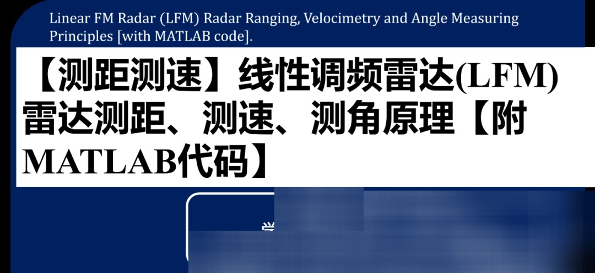

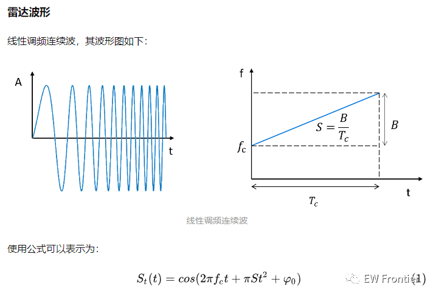
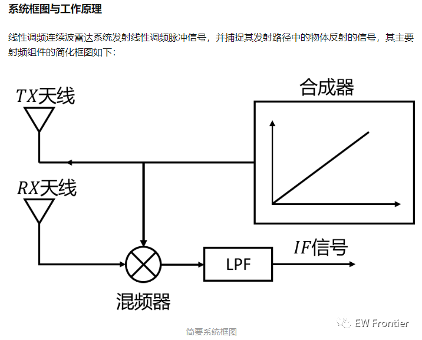
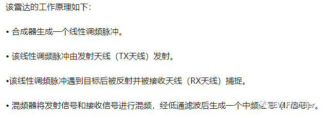
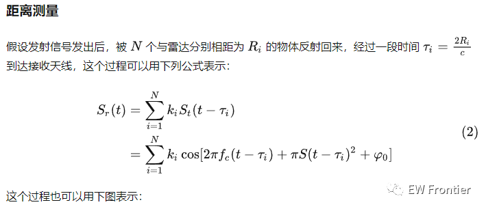
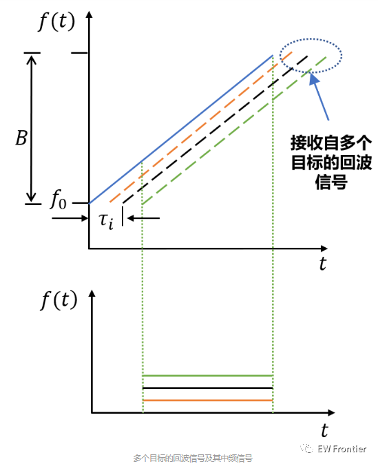
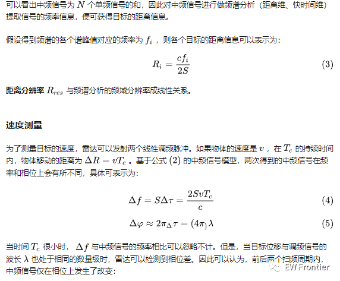
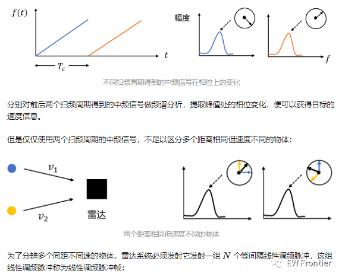
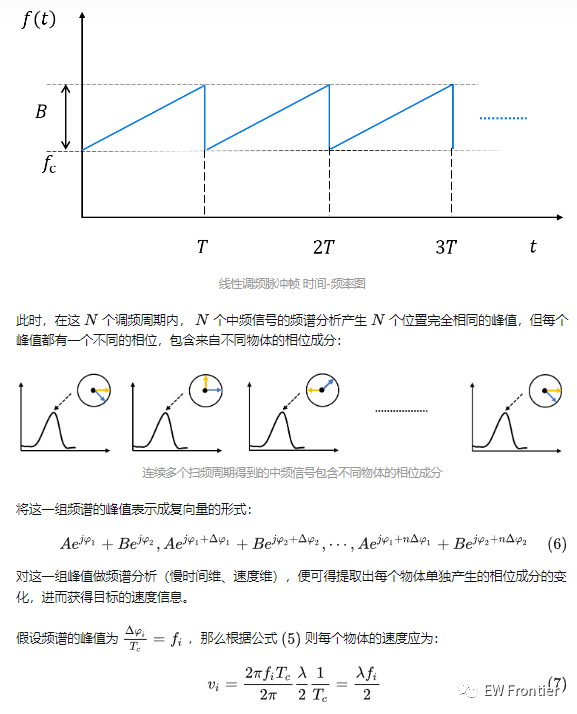
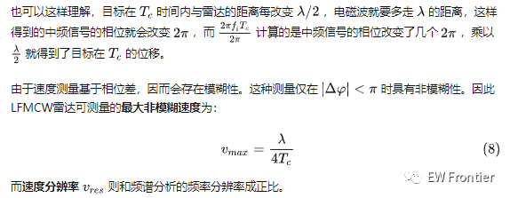
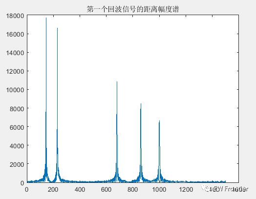
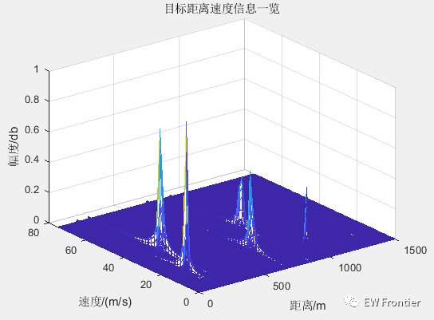

<!-- PAYMENT_BLOCK -->

## Get this dataset

- Payment link (Stripe): [Buy now](https://buy.stripe.com/3cs8yP7sY87d0vu9AB)
- Payment QR code: 

<!-- /PAYMENT_BLOCK -->
